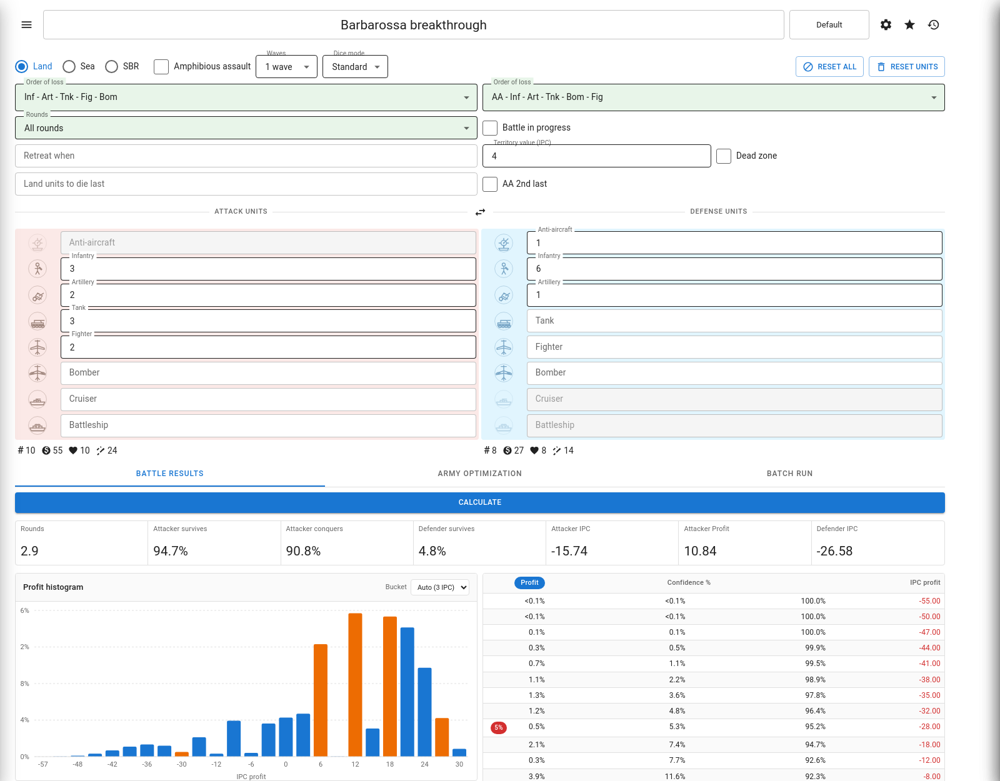
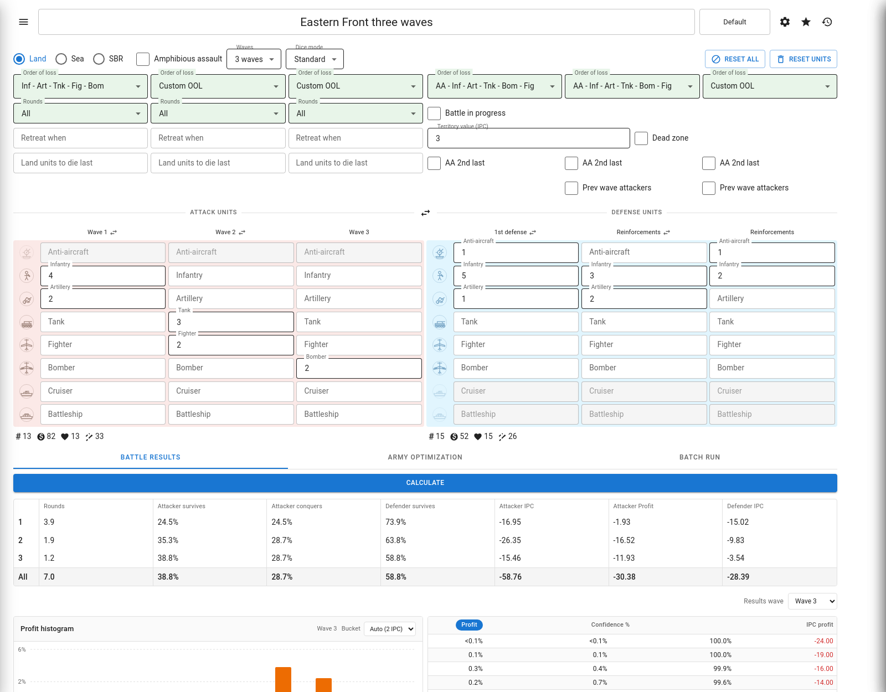
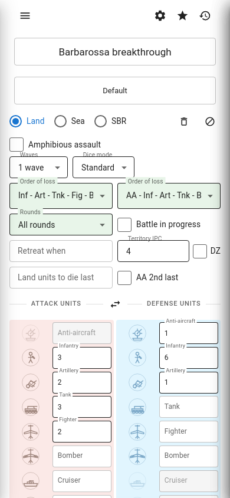
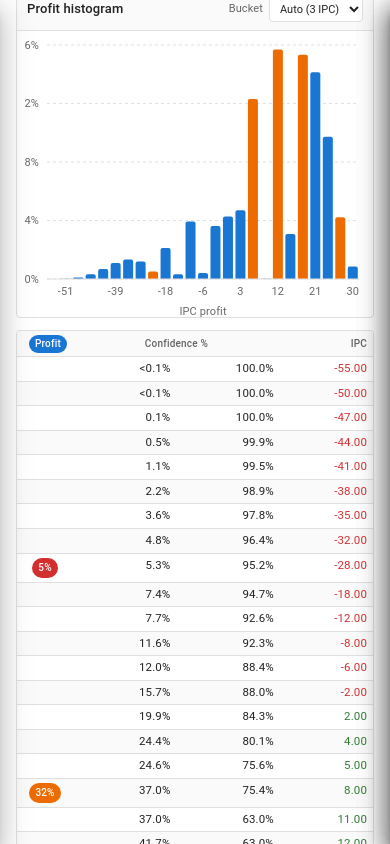
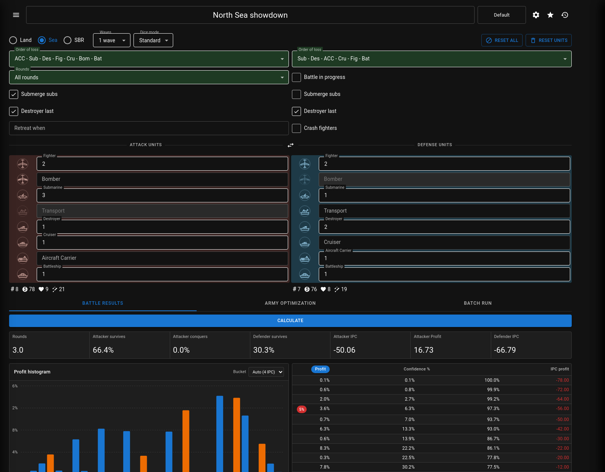
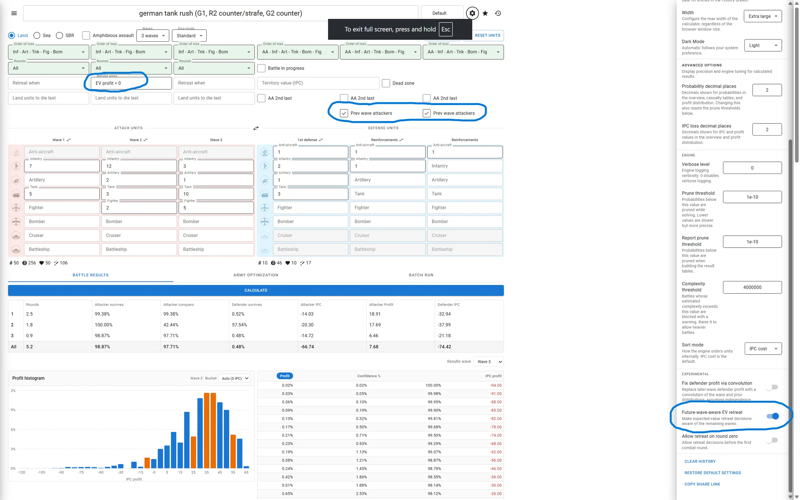
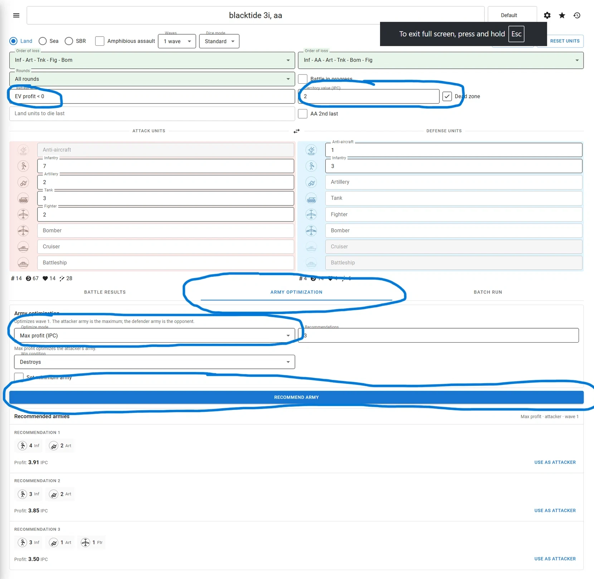
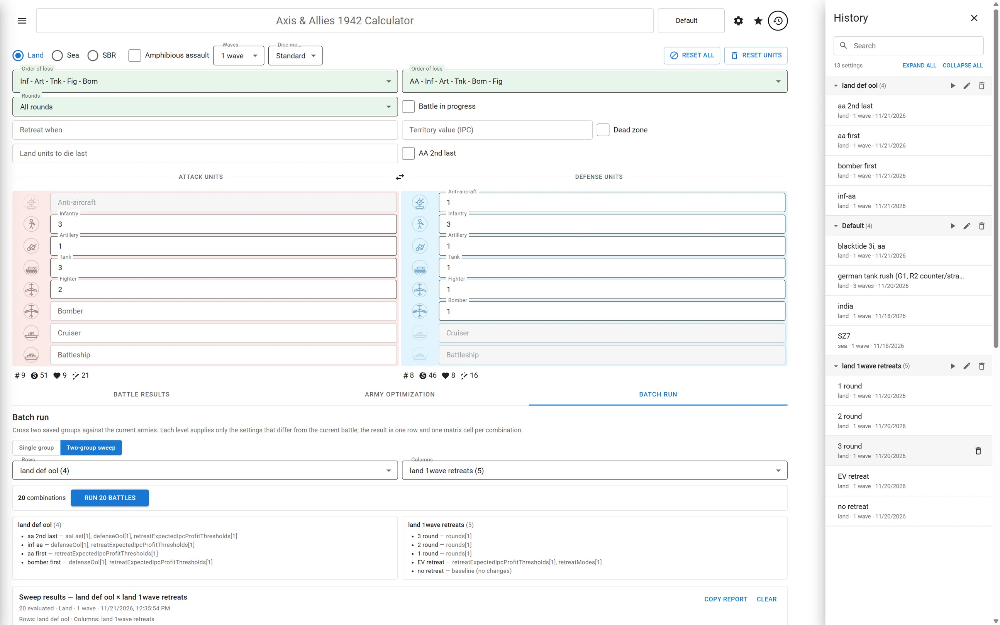
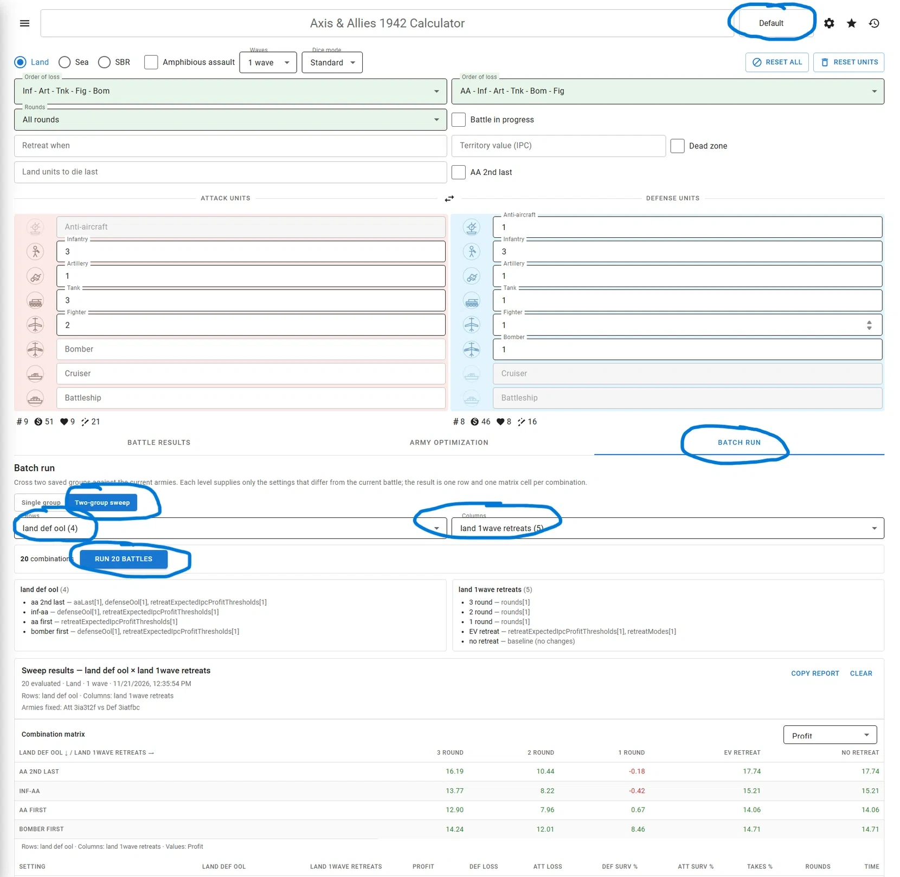

# Axis and Allies 1942 Online probability calculator engine

**Links:**

- [Live calculator](https://mshih01.github.io/aacalc2/) — the classic frontend.
- [Redesigned UI](https://mshih01.github.io/aacalc2/redesign/) — the new
  interface shown below.
- [Discord Server](https://discord.com/channels/606254910438375434/1573788316044623912)

## Screenshots:

The redesigned UI at desktop and mobile widths:

**Desktop** — battle results, and a three-wave battle:





**Mobile** — battle setup and results:

 

**Dark mode** — naval battle:



More screenshots — four waves, army optimization, advanced options, exhaustive
order of loss, and settings — are in
[`frontend/redesign/docs/screenshots`](https://github.com/mshih01/aacalc2/tree/main/frontend/redesign/docs/screenshots).

## Example battles:

Each link below opens the redesigned UI with the battle restored — armies,
order of loss, rounds, retreat rules, and engine options — and recalculates it
on load.

- [Barbarossa breakthrough][barbarossa] — 3 inf, 2 art, 3 tanks, 2 fighters
  vs 6 inf, 1 art, 1 AA; standard dice and a 4 IPC territory.
- [North Sea showdown][north-sea] — 3 subs, 1 destroyer, 1 cruiser,
  1 battleship, 2 fighters vs 1 carrier, 1 battleship, 2 destroyers, 1 sub,
  2 fighters; subs may submerge, destroyers fire last.
- [Eastern Front, three waves][eastern-front] — infantry and artillery, then
  armor and fighters, then a bomber wave; each wave has its own order of loss.
- [Amphibious assault with planned retreat][amphibious] — two rounds of
  amphibious attack, then a follow-up wave.
- [Take or skip the dead zone][dead-zone] — expected-profit retreat on a
  dead-zone territory; the attacker retreats below −2 IPC expected profit.
- [Strategic bombing run][sbr] — three bombers vs AA fire and an industrial
  complex.

[barbarossa]: https://mshih01.github.io/aacalc2/redesign/#/N4IghiBcoAxaBLAdgMygZgDTgE4BcoAmbMHAWw2xQQHMiBfe7AE3hDmhGTUgDYT8UAIwkIkIYxIB7NhwDaXVCAEEBFKrWUgARlIoBdJiGYzO88BGzctpVbnU69W6nUPYAbgBsoMbAAcCcQBTAFohYhAcP2FQ8OwAZwpILj8AYwB9VKl4uzx3KAAWeiA/Barbarossa_breakthrough
[north-sea]: https://mshih01.github.io/aacalc2/redesign/#/N4IghiBcoAxaBnArgIygZgDQgCYFMEoBGbAYwCcljsUwAXakAMwEsBzKAJgF9vsd4IONHClSjWg0glcBLtmRpp2Vh0g8+4APaDhAbRCKQ-OWUrGQki6osotAWxABdTTh0j9h1BfyEzVbDAxW3prdlsHZ00wQg8oOko8aIE4yASkJP4U2HjEzUdIQzwIbAA3ABsoGGwABykiPABaIk5schriJpaFApAWGtIAfVItBAZsOlKq7iA/North_Sea_showdown
[eastern-front]: https://mshih01.github.io/aacalc2/redesign/#/N4IghiBcoAxaBLAdgMygFgDTgE4BcoAmAX2wEZ5cBbKAZmxQQHMjSRDKAjAexshLYATSnGghkaSAFZsYfFDKyIkMmwpiJdWfP5sOG1ESULibMNxFQA2uMPaC2mg2YhsPGgF1y16q5CMWbE17EC92H3dQoQsxURswCCC7XAdfN14-ANDvSHjE2zQQxz9I5xYw-Ty-TQ82ADcAGygYbAAHAhUAUwBaMkJsHFaFHr7sAGc+cVaAYwB9ae4x1Lw6rRAkAHc6YiA/Eastern_Front_three_waves
[amphibious]: https://mshih01.github.io/aacalc2/redesign/#/N4IghiBcoAxaBLAdgMwPoUgZgDTgE4AuGUAjHmPgLYmTkgoIDmUATAL56nwjLqasKRWvUYs67TiAAmPONF6ooAFiGEyFTKSncFfKLgLqJUsAHs5UANqL+INSSE0IeMfZAAjM1RABdLta2jkbBbr5S0hYK8jZgLrbulOpO7l4+rsx+AZCx8fpqidSp3u5hUviWkBx4RJXaeABuADZQMHgADsakAKYAtKSCIPjtZH0DeADOPpC87QDGaHNmE8kghA2teEgA7mwU04T4AK7d7EA/Amphibious_assault_with_planned_retreat
[dead-zone]: https://mshih01.github.io/aacalc2/redesign/#/N4IghiBcoAxaBLAdgMygFgDTgE4BcoAmbMHAWygEYBfa7AE3hDmhGTUgFYT8iSJINOuAD2TFgG02qEDwI8K2FAgDmskACMRFALrD6Y1pPARs7daXm5Fm7euVq92cuKggApgA8ADu4DGeO70AJLefgAKOCLKBMI47q6QALSEwgBuADZQMNjeBILuSZTEIDjeVIXF2ADOFJBsYQD6fiLVVnhpfCD0AF5QeDgAru7UQA/Take_or_skip_the_dead_zone
[sbr]: https://mshih01.github.io/aacalc2/redesign/#/N4IghiBcoAxaAjA9gWygZgL4BoQEZ4cQAmQ3dQogE3hDmhAEsBjKYmIg6I078y3GCS16AbRDI0AXWrCGYpqxm40kEAGcEAJxC4AbgBsoMXAAcALlDwBTALR4TILaat2HudaqanmAfWZI6pa45nrGmEA/Strategic_bombing_run

## Feature examples:

### Take-and-hold with future-wave EV retreat

Three waves: a German attack/take, a Russian counter/strafe, and a German
counter/hold. **Prev wave attackers** makes each wave defend with the previous
wave's surviving attackers. **Future-wave-aware EV retreat** lets the Russian
retreat decision in wave 2 account for the German counterattack in wave 3, so it
optimizes profit across the whole sequence. Each wave's results are shown from
that wave's attacker's point of view; the All-waves row is from wave 1's side.

[][tank-rush]

[Open this battle in the redesign][tank-rush].

[tank-rush]: https://mshih01.github.io/aacalc2/redesign/#/N4IghiBcoAxaBLAdgMygdgDTgE4FsoBWAX2wEZ4Rk1IyAmbMHAFygdwMgGZsUEBzNqRB1K1KD1ytajfFDIxeAosK7xiwgCaU40KqjazpZWZ0lgItYRT0X52cVeyjblsqvXCwAex1QA2vpoRiCmoSB8gtgARt4EALrkAUHhTKxhSlEgsQnOyeIhGRHKMXEg8Vq+erqBdg4GhRzhOeGR5UmQtRD1wVKpcqUEme0iyXUpjUxD2WXDFdgArgAOlDbMOAsApnmQ61vCcno2IJsAHkubAMbMm5oAkkuXAAo43nysB5urUDDCAG4AGx+2CWxk2AFoFNgcCtaBCoSAAM6cKiPAD6l28iPSIGYf2BICQAHcJNhNjQ9ptiEA/german_tank_rush_(G1%2C_R2_counter%2Fstrafe%2C_G2_counter)

### Army optimization

The optimizer can recommend only part of the attacking army. With the territory
treated as a dead zone and an expected-profit retreat, the maximum-profit
recommendation for 7 inf, 2 art, 3 tanks, 2 fighters vs 1 AA + 3 inf is
**4 inf + 2 art** at 3.91 IPC, ahead of 3 inf + 2 art at 3.85 and
3 inf + 1 art + 1 fighter at 3.50.

[][army-optimization]

[Open this battle in the redesign][army-optimization], then choose **Army
optimization → Max profit (IPC)** with win condition **Destroys** and three
recommendations. The link restores the battle, but the optimizer settings are
not part of the share state.

Target-profit optimization is the constrained version: it finds the smallest
army (minimum total IPC value) whose **expected attacker IPC profit** meets a
target. For a defender, target `-20` means "the smallest defending army that
holds the attacker to at most -20 IPC expected profit"; for an attacker, target
`+20` means "the smallest attacking army that earns at least +20". The metric is
the same defender-loss-minus-attacker-loss profit shown in the results, so it
includes captured territory value and the dead-zone counterattack charge. EV
retreat thresholds are honored. Feasibility is not monotonic in army cost (a
larger army can cause an earlier retreat and a *better* attacker profit), so
this mode uses grid search by default; exhaustive search is available for small
pools and is exact.

[army-optimization]: https://mshih01.github.io/aacalc2/redesign/#/N4IghiBcoAxaBLAdgMygdgDTgE4BcoAmbMHAWygGZsUEBzIgX2wEZ5mRD3tL2OATeCDjRwESC2zI0kShzbQOXRTz4kA9kJEBtENJAl8B3BRr1jAI3UUAugM2ide1MbARDBQ6ZC0G2K7Yc5FpQIACmAB4ADmEAxnhh-ACSUbEACjjqtARBYSGQMBwAbgA2UDDYUQQSYQC0LBUgOFFQLHUN2ADOFJB6qQD6seqdniB4RUTY-ABeUHg4AK5h2GEy80uMQA/blacktide_3i%2C_aa

### Batch run: sweeping two history groups

History entries are keyed by `group / name`, and a group can sweep one
dimension of a battle. In this example one group varies the defender order of
loss (`bomber first`, `aa first`, `inf-aa`, `aa 2nd last`), while another varies
the retreat rule (no retreat, EV retreat, 1, 2, or 3 rounds). **Batch run →
Two-group sweep** replays every combination against the current armies — 20
battles here — with each level supplying only the settings it changes, and adds
an axis-by-axis profit matrix.





## Overview:

Axis and Allies odds calculator with advanced features.
- math based probability computation
	- generally faster and more accurate than aa1942calc for most battles.
- basic capabilities
    - land / sea battles with sub/destroyer/air rules.
    - aa guns, shore bombardments
    - custom order of loss
- advanced features inspired by popovitsj's aa1942calc.com.
    - multiwave calculation
    - amphibious assaults with planned retreat (e.g. fight 1 or 2 rounds, then retreat non-amphibious units)
    - standard - biased - lowluck dice
    - strategic bombing analysis.
- new features enabled by the math based approach.
    - retreat if the expected profit is too low.
        - treat the territory as a dead zone
        - consider the territory value for the EV analysis.
    - retreat if the probability of winning is too low (takes / kills)
    - retreat if the probability of losing air is too high
    - retreat if the probability of destroying the defender is too high (strafe / attack to retreat)
	- army recommendation.
		- target win percentage
			- Given an attacking army, defending army, target percentage, and a side to optimize.
				- recommend a subset of the defending army that meets target percentage to defend.
				- recommend a subset of the attacking army that meets target percentage to win. 
		- maximum ipc profit.
			- Given an attacking army and defending army, set the retreat mode to expected profit mode and the territory to is_deadzone.
				- recommend the army that maximizes expected profit.  With EV retreat, and is_deadzone, army smaller than maximum army size may be optimal
		- target ipc profit.
			- Given an attacking army, defending army, target expected attacker profit, and a side to optimize.
				- recommend the smallest (minimum IPC) defending army that holds the attacker to profit <= target.
				- recommend the smallest attacking army that earns profit >= target.
			- uses the engine profit (territory value and dead-zone charge included) and honors EV retreat.

- Take-and-hold analysis: switch sides between waves in multiwave to model taking and holding a territory.
- ev_future_wave -- if ev_retreat is enabled in a multiwave battle -- the retreat condition can optimized overall global profit -- instead of current-wave profit.

## Future work:

- The current cost reporting and EV-based analysis is based on IPC cost of units.  
    - This could be generalized to any arbitrary cost function (user input -- or custom preset)
        - For example a cost function that emphasizes unit count. 
        - Or one that mirrors attack power.
        - Or one that mirrors attack strength.
        - Or a cost function which gives extra weight for losing air 
            - (e.g. a russian/german fighter worth more than others)

- Army recommendation.   
    - Multi-territory defense analysis: (For VC win analysis)
        - Need to optimize odds to hold 3 or more territories.
        - Input:  
            - attacking forces for each of the territories.
            - total number of defending units.
        - Output:
            - the army composition for each territory that maximizes the chance to defend.

## Example usage:

```
const input: MultiwaveInput = {
	wave_info: [
		{
			attack: {
				units: {
					inf: 3,
					arm: 2,
					fig: 3,
				},
				ool: ['inf', 'art', 'arm', 'fig', 'bom'],
				takes: 0,
				aaLast: false,
			},
			defense: {
				units: {
					inf: 5,
					art: 2,
					arm: 1,
					aa: 1,
				},
				ool: ['aa', 'inf', 'art', 'arm', 'bom', 'fig'],
				takes: 0,
				aaLast: false,
			},
			att_submerge: false,
			def_submerge: false,
			att_dest_last: false,
			def_dest_last: false,
			is_crash_fighters: false,
			rounds: 100, // 100 means all rounds.
			retreat_threshold: 0, // retreat if number of attackers <= threshold
			retreat_expected_ipc_profit_threshold: 0, // optional. retreat if the EV less than threshold
		},
	],
	debug: false,
	prune_threshold: 1e-12, // prune threshold during computation
	report_prune_threshold: 1e-12, // prune threshold for reporting only.
	is_naval: false,
	in_progress: false,
	num_runs: 1,
	verbose_level: 0,
	diceMode: 'standard', // standard - lowluck - biased
	sortMode: 'unit_count', // unit_count - ipc_cost
};

let output = multiwaveExternal(input);
```


## Technical overview:

### How it works. 

From a very high level -- the calculator is super simple code. 

The original prototype in C was the following two loops:

```
// initial state probability
//P[N][M] = 1.0;
//P[i][j] = 0.0 for all other i, j;

// the outer loop scheduler
for (i = N; i > 0; i--) {
    for (j = M; j > 0; j--) {
        solve_one_state(problem, i, j);
    }
}

// solve one state.
void solve_one_state(problem, n, m) {
    if (n == 0 && m == 0) {
        return;
    }
    double P0 = Pa[n][0] * Pd[m][0];
    double r = (double)1/(1-P0);
    double prob;
    int i,j;
    int new_i, new_j;
        /*  i att hits, j def hits */
    for (i = 0; i <= n;i++) {
        for (j = 0; j <= M; j++) {
            prob = Pa[n][i] * Pd[m][j] * r * p_init;
            new_i = n-j;
            new_j = m-i;
            if (new_i < 0) new_i = 0;
            if (new_j < 0) new_j = 0;
            P[new_i][new_j] += prob;
        }
    }
    P[n][m] = 0;
}
```

This simple code will solve any battle of N attackers vs. M defenders with fixed order
of losses (no special units like subs, AA's, bombardments).

Pa[i][j] is the probability that i attacking units get j hits.
Pd[i][j] is the probability that i defending units get j hits.

P[i][j] is the probability that we are "currently" in the state i attackers vs. j defenders.

It is initialized to P[N][M] = 1.0, and the rest are zero.

At the end of computation, P[i][j] are the final terminal probabilities.
- P[i][0] is the probability of i attackers vs. 0 defenders.
- P[0][j] is the probability of 0 attackers vs j defenders.
- all other entries will be zeroed

When solve_one_state(i, j) is called, every possible parent state that could lead to this state
has already been solved.   So P[i][j] at this point is the total probability that we 
could reach this state from all parent paths.   After solve_one_state is complete... The value of 
the state is either 0 or the final probability that we end in this state.

### Code overview.

- solve.ts -- solve_general()     
    - solve the problem... Initialize the probability matrix.
    - supporting code to handle AA's, bombardments, schedule solve_one_general_state()

- solveone.ts -- solve_one_general_state()
    - From state (i, j) -- compute the probabilities of all next states (ii, jj).   Update the child state probabilities.
    - it has been structured with callback functions for:
        - onInitState()
        - onExitState()
        - onNextState()

    - The callbacks allow for advanced features like:
        - compute expected value for all sub-problem states.
        - compute Pwin for all sub-problem states.
        - enhance the roundless evaluation to bookkeep and maintain expected number of rounds.

    - However, JavaScript performance issues with high-frequency callbacks led me to duplicate this function (solveone*.ts). When a single callback is used, V8 is able to inline it. But when callbacks are mixed, there is high overhead (2x or more).
    - The duplication is maintained by a shell script.   It's not ideal... and if anyone knows of a better solution please let me know.

- unitgroup.ts -- compute_remove_hits(), general_unit_graph_node
    - compute_remove_hits() handles random order of losses (AA guns, subs/planes/destroyers, multiwave transitions)
        - From an initial set of states (multiple initial states may be possible due to multiwave), compute all possible casualty next states and any other state transitions.
    - general_unit_graph_node
        - From any state -- reach any casualty state with a single table lookup dereference.
            - e.g.  remove 5 sub hits.   remove 8 plane hits.    remove 10 naval hits.
    - The graph nodes are ordered in the node array so that all parent nodes are earlier than all child nodes.

- optimize.ts  -- army recommendation engine...
	- exhaustive search			(exact for small pools; also supports max and target profit)
	- multi-eval accelerated exhaustive search
	- fuzzy binary search		(currently used for target percentage)
	- grid search 			(currently used for max profit and target profit)
	- linear search
	- branch and bound (branchandbound.ts)	exact subset search with cost/profit bounds
	- solver comparison harness: src/regressions/optimizecompare.ts

- multiwave.ts -- multi-wave 

- multieval.ts -- multi-eval.  solve multiple armies at one time to take advantage of subproblem reuse.
		It leads to 10X runtime improvement -- but also large memory overhead.  
		Currently abandoned -- approach in optimize.ts is used instead.

### Frontends and complexity thresholds.

The library is consumed by three frontends:

- aa1942calc.com (external, maintained by popovitsj), which is migrating to this
  engine for calculation. `multiwaveTooComplex()` is primarily for that
  integration: it lets his calculator fall back to Monte Carlo above 250,000.
- `frontend/` in this repo, deployed at
  [mshih01.github.io/aacalc2](https://mshih01.github.io/aacalc2/). It does not
  call `multiwaveTooComplex()`; it calls `multiwaveComplexityFastV2()` directly
  and applies its own `MAX_COMPLEXITY` in `frontend/src/App.tsx` (currently
  4,000,000; previously 400,000).
- `frontend/redesign/`, the redesigned UI deployed at
  [mshih01.github.io/aacalc2/redesign](https://mshih01.github.io/aacalc2/redesign/),
  using the same engine.

The thresholds are independent. Changing `multiwaveTooComplex()` affects
aa1942calc.com, not the bundled frontends.
